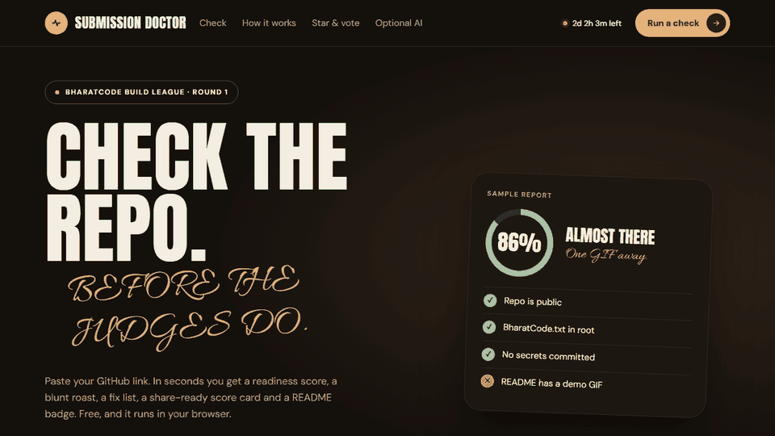

# Submission Doctor

**Check your hackathon repo before the judges do.**

Paste a GitHub link and get a readiness score, a blunt roast, a prioritised fix list, a share-ready score card and a README badge. Built for the BharatCode Build League, free to use and free to host. Everything runs in your browser, so there is no server and no signup.

<!-- Replace with your own recording: save it as demo.gif next to this file -->


## Why it exists

Hackathon projects lose votes for boring reasons: no demo GIF, no install steps, a missing `BharatCode.txt`, or a leaked API key. Stars and votes decide a big part of the ranking, and people rarely check these basics. Submission Doctor checks them in seconds and tells you what to fix first.

## What it does

- **Readiness check (0 to 100).** Public repo, `BharatCode.txt` in the root, README quality (pitch, install steps, demo, BharatCode mention), live demo link, license, description, topics, commit history and obvious committed secrets.
- **Where you'd rank.** A snapshot of the public Build League leaderboard plus a votes what-if calculator. Score is half GitHub stars and half website votes, each measured against the current leader, so right now one vote and one star are each worth roughly 0.8 points (the exact values shift as the leader changes).
- **Fix-it kit.** Copy-paste `README.md`, `BharatCode.txt`, `.gitignore` and `.env.example` templates for whatever your check found missing.
- **Score card and badge.** Download a share image and copy a README badge.
- **Share links.** `?repo=owner/name` opens a finished report.
- **AI review (optional).** Add a BharatCode API key and the model reads your README and results, then tells you what to fix first and writes your submission summary, README intro and launch post.

## How it uses BharatCode

The checks, score and leaderboard panel are plain code and need no model. The **AI review** is the part that calls BharatCode: you enter the base URL, model and your own API key, and the page sends a prompt to `/chat/completions` on that endpoint. The key is kept in your browser and is only sent to the endpoint you enter. It needs an account with BharatCode API access (a Lite or Pro plan, or a verified student account).

## Run it locally

No build step. Serve the folder with any static server:

```bash
python -m http.server 8765
```

Open http://localhost:8765, paste a repo link and click **Diagnose**.

## Deploy free on GitHub Pages

1. Push this folder to a public GitHub repo.
2. Open **Settings → Pages → Build and deployment → Deploy from a branch**, choose `main` and `/ (root)`.
3. Your tool is live at `https://<you>.github.io/<repo>/`.

## Keeping the leaderboard fresh

The Build League API blocks cross-origin browser reads, so the site ships a snapshot in `data/leaderboard.json`. Refresh it and commit the file:

```bash
python scripts/refresh-leaderboard.py
```

## Limits

- GitHub allows about 60 anonymous API requests per hour per IP. Add a free personal access token (no scopes) in the page to raise this to 5,000.
- The secret scan only looks at the repo root, so it is a heuristic and not a security audit.
- Checks are heuristics. The leaderboard is a snapshot and judges' evaluation is not included. Always re-read the official rules on the hackathon page.

## Tech

Plain HTML, CSS and JavaScript. No framework, no build tools. GitHub's public REST API for repo data.

## License

MIT
